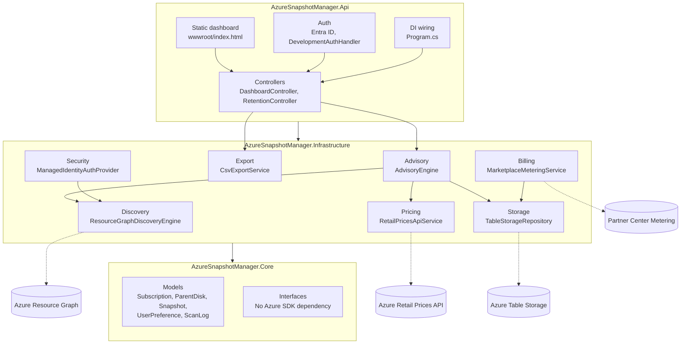

<div align="center">

# Azure Snapshot Manager

[](https://github.com/arun17oct2006/az_snapshot_manager/actions/workflows/ci.yml)

[](LICENSE)

</div>

Finds orphaned Azure disk snapshots (snapshots left behind after their source disk is deleted) that are silently costing money, and surfaces them in a dashboard with one-click portal links, CSV export, and configurable retention rules.

Built as an Azure Marketplace SaaS offer: ARM/`createUiDefinition` packaging, Managed Identity auth, per-tenant Table Storage isolation, and Partner Center metered billing are all part of the design.

---

## Contents

- [Quick start: run v1.0 on your PC](#quick-start-run-v10-on-your-pc)
- [Features](#features)
- [Architecture](#architecture)
- [How the code maps to the design](#how-the-code-maps-to-the-design)
- [Tech stack](#tech-stack)
- [Screenshots](#screenshots)
- [Local development](#local-development)
- [Testing](#testing)
- [Deploying to Azure Marketplace](#deploying-to-azure-marketplace)
- [Free demo hosting (Render)](#free-demo-hosting-render)
- [Building the desktop app yourself](#building-the-desktop-app-yourself)
- [Known limitations](#known-limitations)

---

## Quick start: run v1.0 on your PC

No server or Azure deployment is needed. The app runs as a Windows program on your own computer.

### Requirements

- Windows with PowerShell
- Azure CLI (`az`) installed and configured
- Read access (Reader role) to the subscription you want to audit

### Steps

1. **Go to the GitHub versions.** Open the repository and click **Releases** (or **Tags**) on the right-hand side.
2. **Download v1.0.** Download the v1.0 ZIP file.
3. **Extract everything.** Right-click the ZIP and choose **Extract All**, then extract it into a folder on your computer (for example `C:\AzureSnapshotManager`).
4. **Open the launcher.** In the extracted folder, double-click **`Run Azure Snapshot Manager.bat`**.
5. **Enter your subscription ID if asked.** If the dashboard doesn't find your subscription automatically, paste your subscription ID into the top bar and click **Run audit**.

Your browser opens to the dashboard. Results appear once the audit finishes.

### Troubleshooting

> [!NOTE]
> The Azure CLI must be configured in your local PowerShell first.

- **The app fails to get your subscription:** Sign in again in PowerShell with `az login`, then open the launcher again.
- **Still failing:** Run `az login` one more time, wait for the sign-in to finish, and then relaunch the `.bat` file.
- **Check which account is active:** Run `az account show` to confirm the signed-in account and subscription.

### How access works

The app uses your device's hash to access the subscription, so access follows the device you signed in on. Your data stays in memory and is cleared when you close the window.

---

## Features

- **Automated discovery:** Queries Azure Resource Graph for every disk and snapshot in a subscription, and traces snapshot → parent-disk lineage to flag orphans
- **Live cost estimation:** Prices orphaned snapshots against the Azure Retail Prices API, cached per SKU/region
- **Grouped findings:** Clusters orphans by shared parent disk or resource group, so a whole abandoned VM's snapshots show up as one finding
- **Configurable retention rules:** Exclude snapshots by resource group, name pattern, or a keep-until date, so intentionally kept snapshots aren't flagged
- **One-click remediation:** Every finding links straight to the resource in the Azure Portal
- **CSV export** for reporting outside the dashboard
- **Multi-tenant by design:** Every Table Storage read/write is scoped by subscription ID as the partition key, enforced in one place ([`TableStorageRepository`](src/AzureSnapshotManager.Infrastructure/Storage/TableStorageRepository.cs))

---

## Architecture



`Core` has no outgoing dependencies. That's what lets [`AdvisoryEngineTests`](tests/AzureSnapshotManager.Tests/AdvisoryEngineTests.cs) exercise the orphan-detection and retention-rule logic with mocked discovery, pricing, and storage, without Azure credentials or network access.

---

## How the code maps to the design

| Module | Code |
|---|---|
| Marketplace packaging | [`deploy/mainTemplate.json`](deploy/mainTemplate.json), [`deploy/createUiDefinition.json`](deploy/createUiDefinition.json), [`MarketplaceMeteringService.cs`](src/AzureSnapshotManager.Infrastructure/Billing/MarketplaceMeteringService.cs) |
| Data storage | [`TableStorageRepository.cs`](src/AzureSnapshotManager.Infrastructure/Storage/TableStorageRepository.cs): partition-per-tenant boundary |
| Inventory & discovery | [`ResourceGraphDiscoveryEngine.cs`](src/AzureSnapshotManager.Infrastructure/Discovery/ResourceGraphDiscoveryEngine.cs), [`RetailPricesApiService.cs`](src/AzureSnapshotManager.Infrastructure/Pricing/RetailPricesApiService.cs) |
| Advisory analytics | [`AdvisoryEngine.cs`](src/AzureSnapshotManager.Infrastructure/Advisory/AdvisoryEngine.cs) |
| UI & reporting | [`wwwroot/index.html`](src/AzureSnapshotManager.Api/wwwroot/index.html), [`DashboardController.cs`](src/AzureSnapshotManager.Api/Controllers/DashboardController.cs), [`RetentionController.cs`](src/AzureSnapshotManager.Api/Controllers/RetentionController.cs), [`CsvExportService.cs`](src/AzureSnapshotManager.Infrastructure/Export/CsvExportService.cs) |
| Security & access control | [`ManagedIdentityAuthProvider.cs`](src/AzureSnapshotManager.Infrastructure/Security/ManagedIdentityAuthProvider.cs), Entra ID wiring in [`Program.cs`](src/AzureSnapshotManager.Api/Program.cs), RBAC role assignment in `mainTemplate.json` |

Domain entities (`Subscription`, `ParentDisk`, `Snapshot`, `UserPreference`, `ScanLog`) live under [`Core/Models`](src/AzureSnapshotManager.Core/Models).

---

## Tech stack

.NET 8 · ASP.NET Core Web API · Azure Resource Graph SDK · Azure.Identity (Managed Identity) · Azure Table Storage · Microsoft Entra ID (Microsoft.Identity.Web) · xUnit + Moq · vanilla HTML/CSS/JS dashboard (no frontend framework or build step)

---

## Screenshots

_Add a screenshot of the dashboard (`docs/screenshots/dashboard.png`) and a `dotnet test` run here before sharing this repo publicly._

---

## Local development

### 1. Run the tests (no Azure resources needed)

```bash
dotnet restore
dotnet test
```

### 2. Run the API against a real subscription

```bash
az login
az account set --subscription "<your-subscription-id>"
cd src/AzureSnapshotManager.Api
dotnet run
```

This opens the dashboard at `http://localhost:5080/`. In `Development`, [`DevelopmentAuthHandler`](src/AzureSnapshotManager.Api/Authentication/DevelopmentAuthHandler.cs) auto-authenticates every request and [`InMemorySnapshotRepository`](src/AzureSnapshotManager.Api/Development/InMemorySnapshotRepository.cs) replaces Table Storage. The only real Azure dependency is your `az login` session having Reader access on the subscription.

Paste a subscription ID into the top bar and click **Run audit**. Swagger is available at `/swagger` if you want to call the API directly.

### 3. Configure real auth and storage

Never put real secrets in `appsettings.json`. Use user secrets instead:

```bash
dotnet user-secrets set "AzureAd:TenantId" "<tenant-id>"
dotnet user-secrets set "AzureAd:ClientId" "<app-registration-client-id>"
dotnet user-secrets set "Azure:TableStorageEndpoint" "https://<yourstorageaccount>.table.core.windows.net/"
```

---

## Testing

```bash
dotnet test AzureSnapshotManager.sln
```

Covers [`AdvisoryEngine`](src/AzureSnapshotManager.Infrastructure/Advisory/AdvisoryEngine.cs): orphan detection, multi-resource grouping, retention-rule exclusion, and portal deep-link generation. See [`AdvisoryEngineTests.cs`](tests/AzureSnapshotManager.Tests/AdvisoryEngineTests.cs).

---

## Deploying to Azure Marketplace

### 1. Partner Center setup

1. Create your offer (Azure Application / Managed App, or SaaS) in [Partner Center](https://partner.microsoft.com/dashboard).
2. Upload [`deploy/mainTemplate.json`](deploy/mainTemplate.json) and [`deploy/createUiDefinition.json`](deploy/createUiDefinition.json) as your ARM package.
3. If billing on usage, define metering dimensions matching what [`MarketplaceMeteringService`](src/AzureSnapshotManager.Infrastructure/Billing/MarketplaceMeteringService.cs) sends.
4. Register a multi-tenant Entra ID app for dashboard sign-in.

### 2. Provision and publish

```bash
az deployment group create \
  --resource-group rg-snapshotmgr-test \
  --template-file deploy/mainTemplate.json \
  --parameters appName=snapmgrtest aadTenantId=<tenant-id> aadClientId=<client-id>

dotnet publish src/AzureSnapshotManager.Api -c Release -o ./publish
cd publish && zip -r ../app.zip . && cd ..
az webapp deploy --resource-group rg-snapshotmgr-test --name snapmgrtest-app --src-path app.zip --type zip
```

### 3. Submit

Once the deployed app responds correctly behind real Entra ID auth, follow Partner Center's **Preview → Go live** flow.

---

## Free demo hosting (Render)

The repo includes a `Dockerfile` and [`render.yaml`](render.yaml). The app runs in **demo mode** (`DemoMode=true`): in-memory storage plus a username/password prompt, and a read-only Azure service principal supplied through `AZURE_TENANT_ID`, `AZURE_CLIENT_ID`, and `AZURE_CLIENT_SECRET`. The app refuses to start in demo mode without `DEMO_PASSWORD`.

> [!WARNING]
> Free instances sleep when idle and lose in-memory data on restart, so this is for demos, not production.

---

## Building the desktop app yourself

Only needed if you want to build the Windows app from source instead of using the v1.0 download. Requires the .NET 8 SDK.

```powershell
.\desktop\publish-exe.ps1
```

This publishes a self-contained `AzureSnapshotManager.Api.exe` and a double-click launcher into `desktop/dist/`.

---

## Known limitations

- **Cross-tenant RBAC:** The ARM template grants the Managed Identity `Storage Table Data Contributor` on its own storage account, but reading a customer's subscription via Resource Graph needs a Reader grant at their scope. This is normally handled by the Marketplace Managed Application's built-in Service Provider role, not by this template.
- **Metered billing:** `MarketplaceMeteringService` needs each customer's Marketplace `resourceId`, captured via the SaaS fulfillment webhook. This isn't included here because it depends on which offer type you choose.
- **SDK version drift:** `Azure.ResourceManager.ResourceGraph`'s API has changed across versions. If `dotnet build` fails on `ResourceGraphDiscoveryEngine.cs`, check the resolved package version.

---

## License

[MIT](LICENSE)
